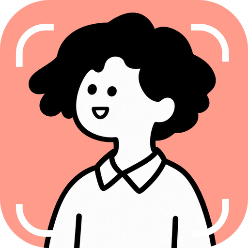
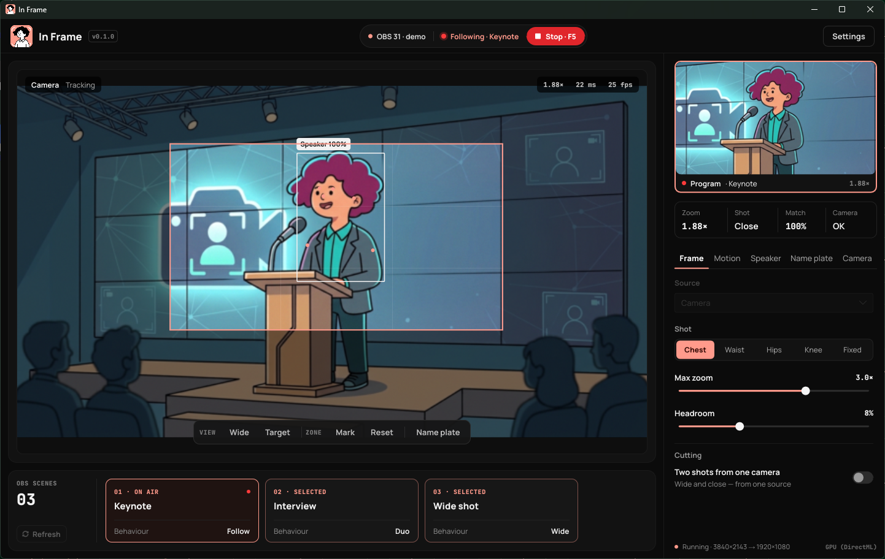
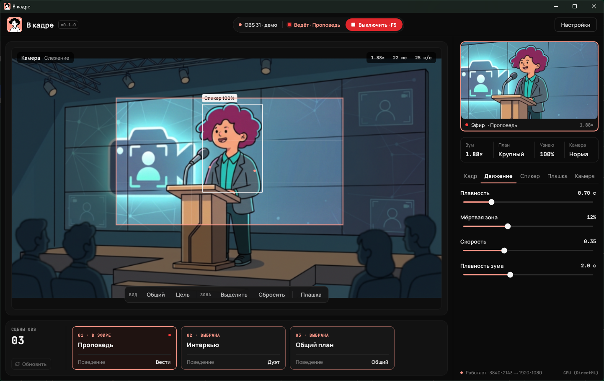
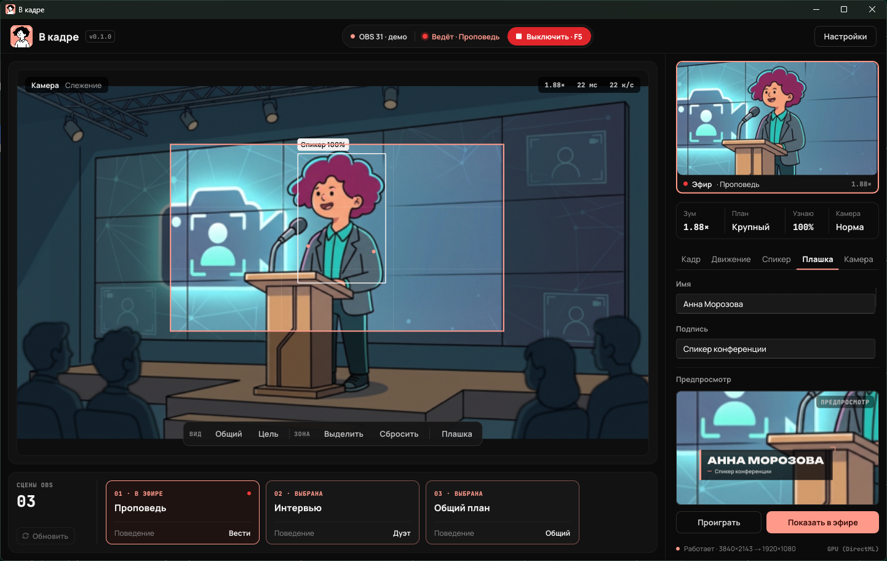
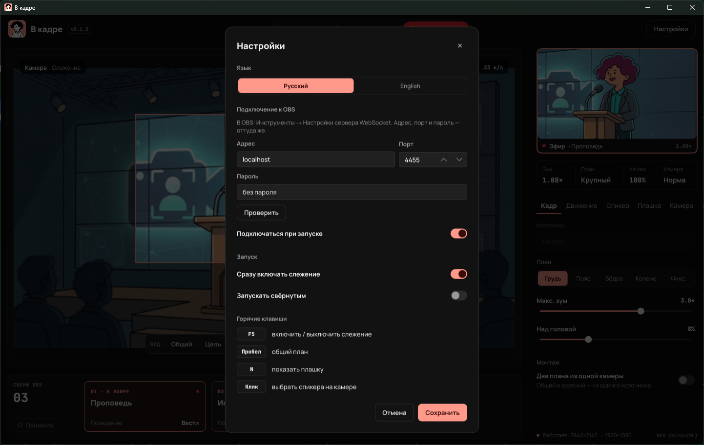

<div align="center">



# In Frame («В кадре»)

**An automatic camera operator for OBS Studio**

One 4K camera films the whole stage; In Frame finds the speaker and smoothly follows them with a crop, like a human camera operator.

[](https://github.com/mynamevladd/v-kadre/actions/workflows/build.yml)
[](LICENSE)


[Download](../../releases) · [Quick start](#quick-start) · [Demo without OBS](#try-it-without-obs) · [Русский](README.md)

</div>



<sub>Left: the whole stage from the camera. The neural net found the speaker (white box); the pink box is the shot that goes on air. Top right: the program output, a close-up. Captured in demo mode from [`docs/demo-stage.jpg`](docs/demo-stage.jpg).</sub>

## Why

One person at a streaming desk cannot switch scenes, watch the audio and follow the speaker with a camera at the same time. In Frame takes the camera off their hands: put one 4K camera on a wide shot, and the program cuts a close-up out of it and moves it with the person — smoothly, without jerks or zoom "pumping". Made for churches, conferences, lectures, school and city events.

## Features

- **Tracks the skeleton, not the face.** A person is recognized even when looking away or standing with their back to the camera. The shot is built from head and torso, so gestures, raised hands and a lectern hiding the legs don't throw it off.
- **A mode per OBS scene**: Follow (the speaker), Duo (two people — interview, interpreter), Wide (the whole stage zone). Works only in the scenes you tick; in Studio Mode the shot is ready before the transition.
- **Click a person in the preview** to follow them.
- **Stage zone**: draw an area with the mouse; people outside it (band, audience) are ignored.
- **Recognizes the speaker by clothing**: if the camera got distracted by someone else, it returns to the speaker as soon as they reappear.
- **Two shots from one camera**: the speaker stands still — close-up; walks — a cut to a medium shot.
- **Name plate**: "Name · title" lower third in OBS by button or the N key, with its own animation and color.
- **Camera watchdog**: black frame, frozen picture, lost signal — an alarm and, optionally, switching the program to a backup scene.
- **Any GPU**: inference on the GPU via DirectML (NVIDIA, AMD, Intel) or on the CPU.
- **Russian and English** interface, switchable on the fly.

## Screenshots



| Name plate | Settings |
|---|---|
|  |  |

## How it works

```
OBS ──(WebSocket: source screenshot, ~10/s)──► YOLO11-pose neural net (ONNX)
                                                 │ people + skeleton keypoints
                                                 ▼
                              tracker (keeps the same person)
                                                 ▼
                    framing: head + torso, dead zones, smoothing
                                                 ▼
OBS ◄──(WebSocket: scene item crop, 30/s)────────┘
```

Nothing is installed into OBS: the program talks to OBS's built-in WebSocket server (OBS 28+). If the program crashes, OBS keeps running. On a normal stop the shot returns to the original.

## Quick start

1. Download `VKadre-windows-x64.zip` from [Releases](../../releases) and unpack it. Keep the `models` folder next to `VKadre.exe`.
2. **OBS:** Tools → WebSocket Server Settings → enable.
3. Create a scene and add the 4K camera as **one** source. In other scenes add the camera as an *Existing source*.
4. Start In Frame and enter the port and password from OBS in **Settings**.
5. Pick the camera and a mode for each scene.
6. **F5** — start tracking. **Space** — wide shot for a moment. **N** — name plate.

## Try it without OBS

Demo mode uses a picture instead of the camera: the neural net, tracker, framing and both monitors all work. Settings are not saved in demo mode.

```bat
VKadre.exe --demo docs\demo-stage.jpg --lang en
```

Any JPG or PNG with people will do; a photo of the whole stage works best.

## Shooting tips

- A 4K camera: a crop up to 2× gives clean 1080p.
- Exposure, white balance and focus on manual. Aperture f/5.6–8 so the whole stage is sharp.
- An LED wall behind the speaker at 30–40 % brightness during the stream.

## Two versions

| Folder | What |
|---|---|
| [`vkadre-rs/`](vkadre-rs) | the main Rust version (Slint): a single exe, half the memory. Build notes in [vkadre-rs/README.md](vkadre-rs/README.md) (Russian) |
| [`speakertrack/`](speakertrack) | the original Python version (PySide6) |

Both share settings: `%APPDATA%\VKadre\settings.json`. Log: `%APPDATA%\VKadre\speakertrack.log`.

## Development

**Rust** — needs Rust (stable, MSVC) and Visual Studio Build Tools with C++:

```bat
cd vkadre-rs
cargo test
cargo run
build.bat               :: release into ..\dist-rs\VKadre.exe + model, with a self-test
```

**Python** — needs Python 3.11:

```bat
setup_dev.bat
run.bat
.venv\Scripts\python -m pytest tests
build.bat               :: dist\VKadre\VKadre.exe
```

Installer: open `installer.iss` in [Inno Setup 6](https://jrsoftware.org/isinfo.php) and press Compile. Self-test without OBS: `VKadre.exe --selftest` (writes the model and device to the log).

The model `models/yolo11n-pose.onnx` is in the repository. To rebuild it or use a bigger one, see `tools/export_model.py` (needs PyTorch and Ultralytics). Custom models go to `%APPDATA%\VKadre\models\`.

## License

[AGPL-3.0](LICENSE). The Ultralytics YOLO11 model is AGPL-3.0, so the whole program is open under the same license. Fonts Unbounded, Manrope and JetBrains Mono are under the [SIL OFL](speakertrack/ui/fonts).
