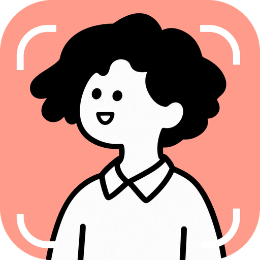
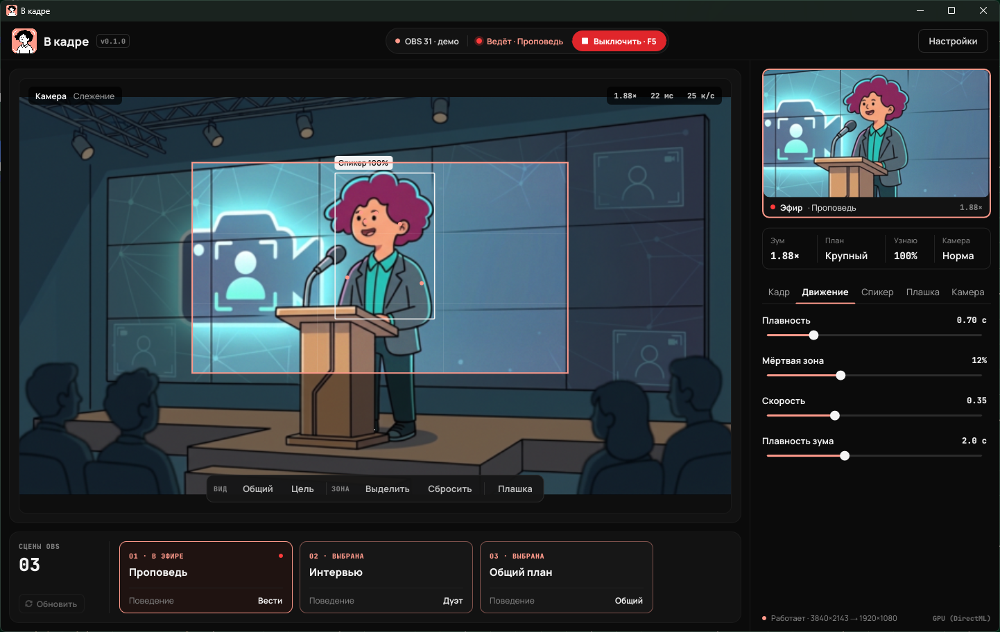
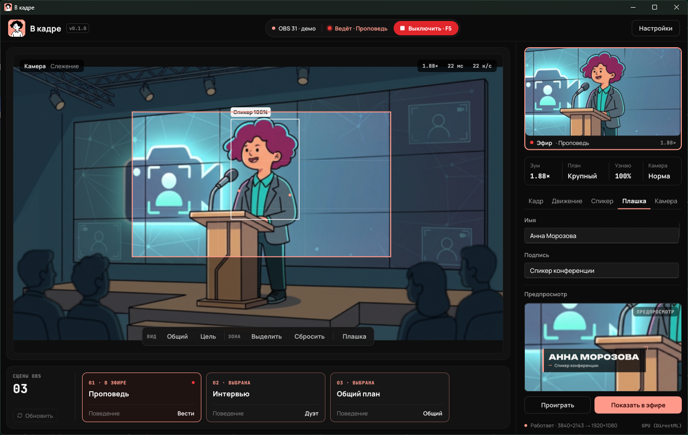
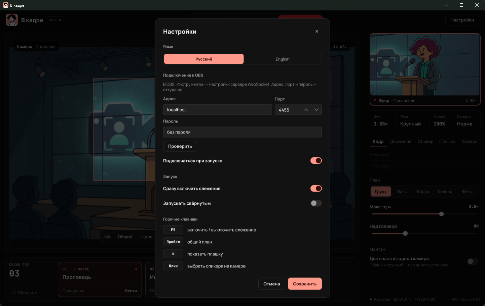
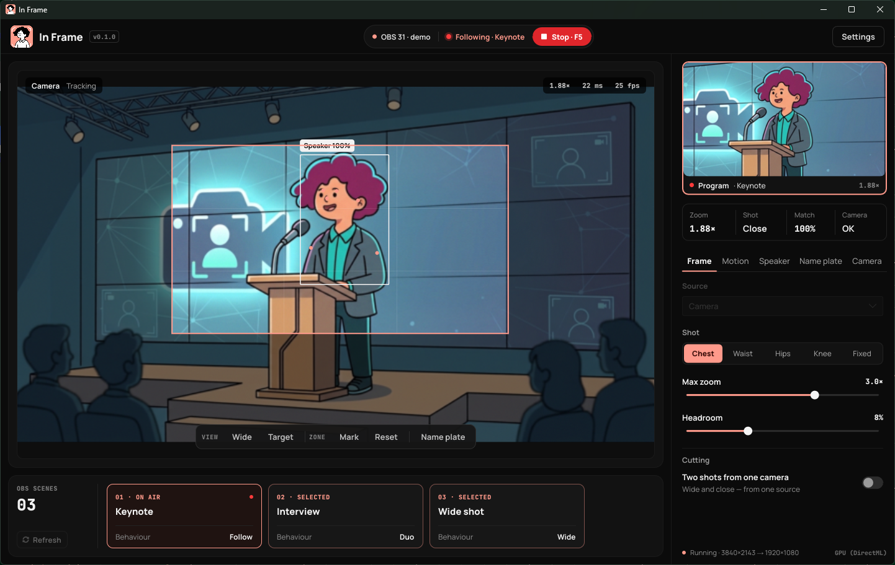

<div align="center">



# В кадре

**Автоматический оператор для OBS Studio**

Камера снимает всю сцену в 4K, а «В кадре» находит спикера и плавно ведёт кадр за ним, как живой оператор.

[](https://github.com/mynamevladd/v-kadre/actions/workflows/build.yml)
[](LICENSE)


[Скачать](../../releases) · [Быстрый старт](#быстрый-старт) · [Демо без OBS](#попробовать-без-obs) · [English](README.en.md)

</div>


<sub>Слева — вся сцена с камеры: нейросеть нашла спикера (белая рамка), розовая рамка — кадр, который уходит в эфир. Справа вверху — сам эфир, крупный план. Снято в демо-режиме, картинка — [`docs/demo-stage.jpg`](docs/demo-stage.jpg).</sub>

## Зачем

Один человек за пультом трансляции не может одновременно переключать сцены, следить за звуком и вести камеру за спикером. «В кадре» берёт камеру на себя: ставите одну 4K-камеру на общий план, а программа сама вырезает из неё крупный план и двигает его вслед за человеком — плавно, без рывков и «наездов». Подходит для церквей, конференций, лекций, школьных и городских мероприятий.

## Возможности

- **Следит по скелету, а не по лицу.** Человек распознаётся, даже когда смотрит в сторону или стоит спиной. Кадр строится по голове и корпусу, поэтому жесты, поднятые руки и кафедра, закрывающая ноги, не сбивают кадр.
- **Режим в каждой сцене OBS**: «Вести» (за спикером), «Дуэт» (двое в кадре — интервью, перевод), «Общий» (вся зона сцены). Работает только в отмеченных сценах; в режиме студии кадр готов ещё до перехода в эфир.
- **Клик по человеку в превью** — следить за ним.
- **Зона сцены**: обведите мышью область, люди вне её (музыканты, зал) игнорируются.
- **Узнаёт спикера по одежде**: если камера отвлеклась на другого человека, она вернётся к спикеру, как только тот снова появится.
- **Два плана из одной камеры**: спикер стоит — крупный, пошёл — монтажная склейка на средний.
- **Плашка с именем**: «Имя · подпись» в OBS по кнопке или клавише N, со своей анимацией и цветом.
- **Сторож камеры**: чёрный кадр, зависшая картинка, пропал сигнал — тревога и, по желанию, переключение эфира на запасную сцену.
- **Любая видеокарта**: распознавание на GPU через DirectML (NVIDIA, AMD, Intel) или на процессоре.
- **Русский и английский** интерфейс, переключается на лету.

## Скриншоты

| Плавность и мёртвая зона | Плашка с именем |
|---|---|
|  |  |
| **Настройки** | **English** |
|  |  |

## Как это устроено

```
OBS ──(WebSocket: скриншот источника, ~10 раз/с)──► нейросеть YOLO11-pose (ONNX)
                                                      │ люди + точки скелета
                                                      ▼
                                   трекер (держит одного и того же человека)
                                                      ▼
                         кадрирование: голова + корпус, мёртвые зоны, сглаживание
                                                      ▼
OBS ◄──(WebSocket: crop элемента сцены, 30 раз/с)─────┘
```

Плагин внутрь OBS не ставится: программа подключается к встроенному в OBS серверу WebSocket (OBS 28+). Если программа упадёт, OBS продолжит работать. При обычной остановке кадр возвращается к исходному.

## Быстрый старт

1. Скачайте `VKadre-windows-x64.zip` со страницы [Releases](../../releases) и распакуйте. Папка `models` должна лежать рядом с `VKadre.exe`.
2. **OBS:** Инструменты → Настройки сервера WebSocket → включить.
3. Создайте сцену (например, «Проповедь») и добавьте в неё 4K-камеру **одним** источником. Для других сцен добавляйте камеру как *Существующий источник*.
4. Запустите «В кадре», в **Настройках** введите порт и пароль из OBS.
5. Выберите камеру и режим для каждой сцены.
6. **F5** — включить слежение. **Пробел** — временно общий план. **N** — плашка.

## Попробовать без OBS

Демо-режим подставляет картинку вместо камеры: работают нейросеть, трекер, кадрирование и оба монитора. Настройки в демо-режиме не сохраняются.

```bat
VKadre.exe --demo docs\demo-stage.jpg
VKadre.exe --demo мой-кадр.jpg --lang en
```

Подойдёт любой JPG или PNG с людьми; лучше всего — снимок сцены целиком.

## Советы по съёмке

- Камера в 4K: кроп до 2× даёт чистый 1080p.
- Экспозиция, баланс белого и фокус на камере — ручные. Диафрагма f/5.6–8, чтобы вся сцена была резкой.
- LED-экран за спикером на время трансляции — на 30–40 % яркости.

## Две версии

| Папка | Что это |
|---|---|
| [`vkadre-rs/`](vkadre-rs) | основная версия на Rust (Slint): один exe, вдвое меньше памяти. Сборка и устройство — в [vkadre-rs/README.md](vkadre-rs/README.md) |
| [`speakertrack/`](speakertrack) | исходная версия на Python (PySide6) |

Настройки у версий общие: `%APPDATA%\VKadre\settings.json`. Лог: `%APPDATA%\VKadre\speakertrack.log`.

## Для разработки

### Rust

Нужны Rust (stable, MSVC) и Visual Studio Build Tools с C++.

```bat
cd vkadre-rs
cargo test              :: тесты
cargo run               :: запуск (отладка)
build.bat               :: релиз в ..\dist-rs\VKadre.exe + модель, с самопроверкой
```

### Python

Нужен Python 3.11.

```bat
setup_dev.bat        :: создаёт .venv и ставит зависимости
run.bat              :: запуск программы
.venv\Scripts\python -m pytest tests
build.bat            :: сборка в dist\VKadre\VKadre.exe
```

Установщик: поставьте [Inno Setup 6](https://jrsoftware.org/isinfo.php), откройте `installer.iss` и нажмите Compile. Получится `dist\VKadre-Setup-0.1.0.exe`.

Проверка сборки без OBS: `VKadre.exe --selftest`. Результат (модель и устройство) пишется в лог.

### Модель

Файл `models/yolo11n-pose.onnx` уже лежит в репозитории. Чтобы пересобрать его или взять модель крупнее, используйте отдельное окружение с PyTorch:

```bat
pip install torch torchvision --index-url https://download.pytorch.org/whl/cpu
pip install ultralytics onnx onnxslim
python tools/export_model.py yolo11n-pose 640
```

Пользовательские модели можно класть в `%APPDATA%\VKadre\models\`.

### Структура (Python)

| Файл | Что делает |
|---|---|
| `speakertrack/framing.py` | расчёт кадра: поза → окно кропа, мёртвые зоны, сглаживание (чистая логика) |
| `speakertrack/tracker.py` | лёгкий трекер людей между кадрами |
| `speakertrack/detector.py` | ONNX Runtime: подготовка картинки, разбор выхода YOLO-pose, NMS |
| `speakertrack/obs_client.py` | обёртка над obs-websocket v5 |
| `speakertrack/engine.py` | потоки распознавания и отправки в OBS, режимы сцен, выбор спикера, монтаж |
| `speakertrack/appearance.py` | «отпечаток» одежды спикера (цветовая гистограмма торса) |
| `speakertrack/watchdog.py` | сторож камеры: чёрный / зависший кадр, нет сигнала |
| `speakertrack/lower_third.py`, `overlay/lower_third.html` | плашка с именем: страница для Browser Source и управление ей в OBS |
| `speakertrack/ui/` | окно PySide6: превью, настройки, подключение |
| `speakertrack/settings.py` | настройки в `%APPDATA%\VKadre\settings.json` |

## Лицензия

[AGPL-3.0](LICENSE). Модель YOLO11 от Ultralytics распространяется под AGPL-3.0, поэтому вся программа тоже открыта под этой лицензией. Шрифты Unbounded, Manrope и JetBrains Mono — под [SIL OFL](speakertrack/ui/fonts).
